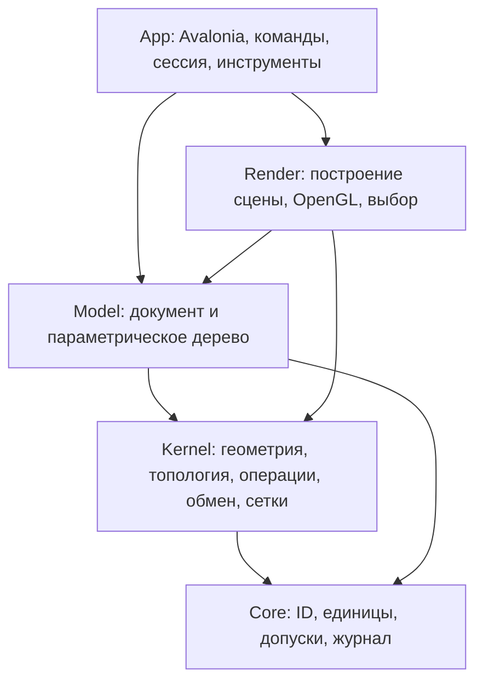

# Parametric3D: карта сущностей и процессов

Карта составлена 11.11.2026 по исходникам пользовательского `src.zip` и сохранённой инфраструктуре репозитория. Наличие реализации не означает универсальную геометрическую корректность: ограничения и результаты проверок вынесены в `../docs/REQUIREMENTS_REVIEW.md` и `../docs/SYNC_AUDIT_2026-11-11.md`.

## Иерархия целей

- **Глобальная цель:** собственный CAD для параметрического инженерного моделирования с проверяемой геометрией и дальнейшим подключением расчёта.
- **Цель ядра:** возвращать тело с явными гарантиями, диагностикой, происхождением и контролем допусков, а не скрывать отказ точного пути удачной картинкой.
- **Цель модели:** воспроизводимо перестраивать дерево операций, сохранять параметры и ссылки, обеспечивать откат и обмен.
- **Цель приложения:** дать пользователю создание, редактирование, просмотр и проверку детали, сборки и чертежа.
- **Ближайшая цель поставки:** сохранить новый код резьбы, комплектовать его таблицами и проверить новые функции, не потеряв корпус регрессии.

## Границы компонентов



Это логические подсистемы одной сборки, не отдельные публичные DLL. `OutputType=WinExe`, `TargetFramework=net8.0`, UI на Avalonia 12.1.4; зависимости и включаемые каталоги определены в `Parametric3D.csproj`. Старый запрос об одном native DLL-проекте не является описанием текущей C#-поставки.

Основные вычисления можно собирать без окна: `tests/k01/K01Checks.csproj` включает `Core`, `Kernel`, `Model` и тестовый `App/Diagnostics/TestParts.cs`. Это подтверждает возможность headless-проверки, но не означает, что уже подготовлен стабильный API отдельной CAD DLL.

## Сущности ядра

| Сущность / подсистема | Назначение и связи | Где смотреть |
|---|---|---|
| `TEntity` | ID, метка, защита изменений опубликованной топологии | `Kernel/Topology/Topology.cs` |
| `TVertex` | Точка и инцидентные рёбра | там же |
| `TEdge` | Две вершины, пространственная `ICurve3`, использования в гранях, допуск | там же |
| `TCoEdge` | Ориентированное использование общего ребра в контуре | там же |
| `TLoop` | Упорядоченный внешний или внутренний контур из coedge | там же |
| `TFace` | `ISurface3`, контуры, ориентация и принадлежность оболочке | там же |
| `TShell` / `TSolid` | Грани оболочки; оболочки тела, ревизия, публикация и представления | там же |
| `ICurve3` / `ISurface3` | Геометрия отдельно от топологических связей; аналитика, NURBS, процедурные формы | `Kernel/Curves`, `Kernel/Surfaces` |
| `OperationResult` | Исход операции, тела, сообщения, гарантии, отчёт точности | `Kernel/OperationResult.cs` |
| `KernelContext` | Настройки и состояние конкретного вычисления, контроль отмены | `Kernel/KernelContext.cs`, `KernelOptions.cs` |
| `Provenance` и ссылки | Происхождение и разрешение ссылок после правок; неоднозначность не равна успеху | `Kernel/Topology`, `Model/Features/*Refs.cs` |
| Аналитический / рациональный / приближённый пути | Разные способы получения результата, не одинаковый уровень гарантии | `Kernel/Analytic`, `Kernel/Geometry`, `Kernel/Exact`, `Kernel/Ops/BooleanOp.cs` |
| SSI | Пересечения поверхностей и построение согласованных кромок | `Kernel/Geometry/Ssi.cs`, `NurbsSsi.cs`, `ExactEdges.cs` |
| Производные сетки | Треугольники отображения/экспорта и отдельная расчётная сетка | `Kernel/Tess`, `Model/DisplayCache.cs` |

`GuaranteeLevel` различает `Unspecified`, `ExactPolyhedral`, `ExactQuadric`, `ExactAnalytic`, `Approximate`. Слово `ExactPolyhedral` не означает точную исходную криволинейную поверхность: это гарантия многогранного пути после входного округления.

## Сущности модели и приложения

| Сущность | Роль | Реализация |
|---|---|---|
| `Document` | Корень, параметры, настройки, материалы, поиск деталей/эскизов | `Model/Document.cs` |
| `Assembly` / `Part` | Иерархия компонентов; упорядоченные фичи, тела и состояние детали | `Model/Assembly.cs`, `Part.cs` |
| `Feature` / `BuildContext` | Одна операция истории и контекст её выполнения | `Model/Features/Feature.cs` |
| `Sketch` | Геометрия, размеры, ограничения, связанные ссылки и решение | `Model/Sketching` |
| `ParameterTable` / `ValueRef` | Именованные параметры, выражения и значения операций | `Model/Params` |
| `Material` / `FaceSet` | Материалы и именованные наборы граней для инженерных назначений | `Model/Material.cs`, `FaceSets.cs` |
| `Quilt`, свободные формы, SubD | Наборы поверхностей и свободное моделирование | `Model/Quilt.cs`, `FreeFormSurfaces.cs`, `SubD.cs`, `Features/SurfaceFeatures.cs` |
| Сопряжения, конфигурации, разнесённый вид | Дополнительные состояния модели сборки | `Model/Mates`, `Configuration.cs`, `ExplodedView.cs` |
| `DocumentFile`, `DocumentStorage`, `AssemblyFile` | Сериализация, файловые контейнеры, сохранение детали/сборки | `Model` |
| `DocumentSession` / `UndoHistory` | Открытый документ и транзакция пользовательской правки | `App/Services/DocumentSession.cs`, `Model/UndoHistory.cs` |
| `AppCommand` / `CommandRegistry` | Имена, доступность и запуск команд | `App/Commands` |
| `FeatureOp` / `OpPanel` | Панель параметров, ссылки, предпросмотр, принятие/отмена | `App/Operations` |
| `ModelViewport` / `Selection` / `ScenePicker` | Навигация, ввод и выбор | `App/Viewport` |
| `SceneBuilder` / `SceneData` / `SceneRenderer` | CPU-сцена, данные отрисовки, GL-проходы и GPU-выбор | `Render/Engine` |
| Чертёж, лист, проекция, BoM | Производные представления детали и сборки | `Model/Drawing`, `App/Views/Sheet*`, `App/Services/Drawing` |
| MCP | Машинный вход для команд и взаимодействия с приложением | `App/Services/Mcp` |

## Процессы

### Пользовательская операция и перестроение

```text
Команда → панель FeatureOp → выбор ссылок и параметров
    → предпросмотр / Execute(BuildContext)
    → принятие правки DocumentSession либо отмена
    → дерево Part.Features → разрешение параметров, эскизов и ссылок
    → операция Kernel → диагностика и результирующие тела
    → обновление состояния модели и сцены
```

Отмена правки приложения и защита опубликованного тела ядра являются разными механизмами. Сохранённые состояния и display cache ускоряют некоторые сценарии, но не доказывают отсутствие полного перестроения при любой ранней правке.

### Геометрическая операция

```text
Операнды и политика → проверка входа → выбор допустимого маршрута
    → аналитический / точный многогранный / разрешённый приближённый расчёт
    → пересечения, классификация, топологическая сборка
    → проверка результата и допусков
    → OperationResult: outcome, guarantee, diagnostics, accuracy
```

Основной диспетчер Boolean находится в `Kernel/Ops/BooleanOp.cs`; локальные скругления и фаски распределены по `DirectRound*.cs`, `FilletOp.cs` и связанным построителям. Политика и семейство входа определяют доступность fallback; нельзя описывать все операции одним универсальным алгоритмом.

### Отображение и выбор

Модель передаётся в `SceneBuilder`, сцена рисуется `SceneRenderer`, а ввод обрабатывает `ModelViewport`. Существуют GPU-выбор и отдельный `ScenePicker`; старая инструкция «выбор только лучом, не через framebuffer» больше не описывает весь текущий путь.

Тесселяция должна оставаться производной от геометрии, а не менять её ради изображения. Авторитетность поверхностей, revision/cache и проверки тела следует рассматривать отдельно от визуальной гладкости.

### Файлы и обмен

```text
.p3d → DocumentStorage / DocumentFile / AssemblyFile → дерево модели
STEP / IGES / Parasolid / SLDPRT / STL → Exchange + Kernel/Export / MeshFit
    → чтение → восстановление / лечение → проверки → добавление в документ
Модель → точный STEP либо сеточный STL/OBJ
```

Наличие импортера не означает поддержку любого файла этого формата. Корпуса и ограничения находятся в `../BACKLOG.md`, `docs/release/KNOWN_LIMITATIONS.md` и тестах; старые проценты охвата не пересчитывались в этом аудите.

### Резьба из нового архива

```text
CosmeticThreadOp → CosmeticThreadFeature
    → цилиндрическая грань, ось, начало, длина, направление
    → ThreadDb: JSON/CSV → ThreadSpec
    → ShowPreview: только линии, без построения/выреза тела
    → полный наружный цилиндр: ThreadSection → PeriodicSweepOp
        → одна ячейка → точные копии → общие рёбра стыков → отдельный остаток
    → другие случаи: точный винтовой инструмент + строгий Boolean, возможен отказ
    → плавный выход на наружном цилиндре: ThreadRunoutOp → DirectRoundThread
        → одна постоянная ячейка и копии → отдельное аналитическое окончание
        → неподдержанная конфигурация: явный отказ без изменения тела
    → DocumentFile сохраняет параметры → SceneBuilder показывает линии
```

Код находится в `App/Operations/ThreadOp*.cs`, `Model/Threads` и `Model/Features/ThreadFeature*.cs`. Пользовательские JSON/CSV включены в поставку: 308 номинальных типоразмеров, без полей допусков. Для резьбы `SweepOp.BuildByLaw(requireExact: true)` запрещает многогранную подмену. Без выхода `PeriodicSweepOp` переносит ячейку и её сетку, удаляет внутренние торцы, сшивает ссылки топологии и проверяет оболочку; профиль содержит дуги и ограниченную по ошибке аппроксимацию спирали кривыми Безье. С выходом `ThreadRunoutOp` использует формульные линейчатые полосы, копии постоянной ячейки и отдельное окончание с C1-отводом резца; начало должно находиться на торце отдельного наружного цилиндра, а окончание допускается до второго торца. Новый путь ограничен однозаходным четырёхточечным трапециевидным профилем. Подробные ограничения и замеры: `docs/THREAD_IMPLEMENTATION_STATUS.md` в корне репозитория.

### Расчётная сетка и будущая FEA

В этом CAD уже есть `AnalysisMesher`, `TetMesher`, `TetFlips`, `MeshQuality` и `Render/Engine/FeaRemesh.cs`. Последний строит линии сетки для вида из треугольников отображения, не объёмную расчётную сетку; наличие этих компонентов не равно полноценному решателю FEA или промышленной сетке для произвольных полостей и материалов.

Отдельная `Parametric3D.Fea` сюда не интегрирована. Будущий адаптер должен явно передавать геометрию границы, ориентацию, ID граней/регионов, единицы и допуски, а получать сетку с качеством, принадлежностью границе и диагностикой; это направление интеграции, не реализованный контракт текущей сборки.

## Проверки и точки развития

- **Вычисления:** `tests/k01`; остальные тестовые проекты и корпуса сохранены, а не удалены из-за отсутствия в `src.zip`.
- **Приложение:** `tests/ui` и `App/Diagnostics`; сборка headless-ядра не проверяет окно, GL и Windows.
- **Выпуск:** `run.*`, `regress.*`, `tools/make_package.*`, `.github/workflows`.
- **Надёжность:** сохранять строгие исходы и диагностику, расширять репродукторы для неподдержанных сопряжений, импорта и сеток.
- **Производительность:** сравнивать один корпус и настройки, фиксировать время/память/отказы; не переносить старые коэффициенты ускорения на новый код.
